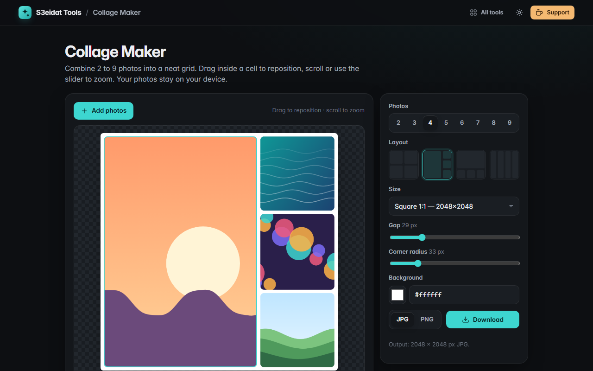

# Collage Maker

> Combine photos into a neat grid collage. Free, private, and it runs entirely in your browser.

### ▶ [Open Collage Maker](https://s3eidat.github.io/collage-maker/)



## Features

- **2 to 9 photos**, with several layouts for each count (grids, big-photo layouts, mixed rows and columns)
- Drop or paste photos, or click any empty cell to fill it; extra photos grow the layout automatically
- **Pan** by dragging inside a cell and **zoom** with the mouse wheel or the slider
- Swap a photo with its neighbour, replace or remove it
- **Gap**, **corner radius** and **background colour**
- Output sizes: square, Instagram portrait 4:5, story 9:16, landscape 16:9 and 3:2, A4 print at 300 dpi
- Download as **JPG or PNG** at full size
- Keyboard: `1`–`9` select a cell, arrows pan, `+`/`-` zoom, `Enter` adds a photo, `Delete` removes it

## Privacy

Your photos never leave your device: the collage is drawn on a `<canvas>` in this page. There is no server,
no account, no analytics. The page ships with a strict Content-Security-Policy (`connect-src 'self'`),
so the browser itself blocks any attempt to send data anywhere.

## Run it yourself

It's plain HTML, CSS and JavaScript with no build step:

```bash
git clone https://github.com/s3eidat/collage-maker
cd collage-maker
python -m http.server 8000
```

Then open http://localhost:8000.

## Support

If this saved you time, **[buy me a coffee ☕](https://s3eidat.github.io/coffee/)**. It keeps every tool free.

---

Part of **[S3eidat Tools](https://s3eidat.github.io/)**: 100+ free, private tools that run in your browser. MIT licensed.
